  

  <a href="README.md">🇬🇧 English</a> · 🇪🇸 Español

  

  🟣 <b>Busco mi primera experiencia en tecnología</b> · Acepto trabajo remoto · Mendoza, Argentina (UTC-3) 
  Disponibilidad inmediata · Full time o part-time  
  
  

✦ ✦ ✦

## 👋 Sobre mí

Soy estudiante de Desarrollo de Software en **ITU Mendoza**. Me gusta construir proyectos reales, aprender haciendo y trabajar en equipo. Tengo una base sólida en backend (Java, Spring Boot, Python) y estoy creciendo en desarrollo web y móvil moderno (React, TypeScript, Flutter, Firebase) con testing automatizado.

## 🚀 Proyectos

### 🛒 Tienda Demo
 

Tienda online completa con **panel de empleado** (carga de productos, categorías y banners) y **vista de cliente** (catálogo y carrito, al estilo Mercado Libre u OnCity). Es una demo a propósito: sirve de base para adaptarla a cualquier rubro.

  
  

- **Lo técnico:** validación de stock en tiempo real, carrito persistente, transacciones atómicas, protección contra XSS y **40 tests end-to-end** automatizados.
- **Stack:** JavaScript · Firebase (Firestore y Auth) · Cloudinary · Playwright
- 📂 [Repositorio](https://github.com/AgusBAlvarez/tienda-demo) · 🔗 [Demo en vivo](https://tienda-demo-5c115.web.app/catalogo/)

 

### 🪑 Configurador y despiece de muebles
  

Ingresás las medidas de un mueble, elegís una plantilla y lo ves en **3D**. Si te convence, la app genera el **despiece**: la lista de piezas a cortar con sus medidas.

  
  

- **Mi parte:** el módulo de **despiece**. El equipo se dividió en componentes, modelado 3D, nube y seguridad, y despiece.
- **Stack:** React · TypeScript · React Three Fiber · Drei · React Router · Firebase (Firestore) · Cloudflare
- **Cómo trabajamos:** issues, pull requests y GitHub Actions (CI).
- 🔒 Repositorio privado (proyecto en equipo) · código disponible a pedido

 

### 🚦 EcoRuta
  

App móvil para **descongestionar el tránsito del centro en hora pico**: muestra el mapa con el estado del tránsito, calcula rutas y permite programar alarmas.

  
  
  

- **Mi parte:** programadora del equipo; trabajamos en conjunto sobre todo el código.
- **Stack:** Flutter · Dart · Firebase Auth (email y Google) · TomTom API (mapas, tránsito y rutas) · SQLite
- **Calidad:** arquitectura MVVM en capas, tests unitarios, de widget y de integración, CI con GitHub Actions.
- 🔒 Repositorio privado (proyecto en equipo) · código disponible a pedido

 

### 🧠 FastQuiz
 

Herramienta de estudio con IA: subís tus apuntes y genera **cuestionarios y resúmenes** usando OCR y un modelo de lenguaje. Proyecto en equipo con Scrum.

- **Stack:** Python · Node.js · MongoDB · LLaMA (Groq API) · Tesseract OCR

✦ ✦ ✦

## 🤝 Cómo trabajo
Trabajo en equipo con **Git**, **issues y pull requests**, **integración continua (GitHub Actions)** y testing automatizado, bajo metodología **Scrum**.

## 🛠️ Tecnologías

  
  
  
  
  
  

  
  
  
  
  

  
  
  
  
  
  
  

### 🌱 Aprendiendo ahora

## 🎓 Formación
- **Tecnicatura en Desarrollo de Software**, ITU Mendoza (2024 – 2027, en curso)
- **AWS Academy Cloud Foundations** (Dic. 2025)
- **Git y GitHub**, Casa del Futuro (Feb. 2026)
- **Programación con Python**, Fundación Educativa Santísima Trinidad (Oct. 2026)
- **Inglés B1**, Facultad de Filosofía y Letras (Jul. 2026)

## 🌍 Idiomas
🇪🇸 Español: nativo · 🇬🇧 Inglés: B1, mejorando cada día

✦ ✦ ✦

## 🌌 Mi galaxia de GitHub

  

¿Charlamos? 👉 <a href="mailto:agustinaalvarezb8@gmail.com">agustinaalvarezb8@gmail.com</a>

