  

  🇬🇧 English · <a href="README.es.md">🇪🇸 Español</a>

  

  🟣 <b>Open to my first tech role</b> · Remote-friendly · Based in Mendoza, Argentina (UTC-3) 
  Available immediately · Full-time or part-time  
  
  

✦ ✦ ✦

## 👋 About me

I'm a Software Development student at **ITU Mendoza**. I like building real projects, learning by doing and working in a team. I have a solid base in backend (Java, Spring Boot, Python) and I'm growing in modern web and mobile development (React, TypeScript, Flutter, Firebase) with automated testing.

## 🚀 Projects

### 🛒 Demo Shop
 

A complete online store with an **employee panel** (manage products, categories and banners) and a **customer view** (catalog and cart, similar to Mercado Libre). It is a demo on purpose: it can be adapted to any kind of business.

  
  

- **Under the hood:** real-time stock validation, persistent cart, atomic database transactions, XSS protection and **40 automated end-to-end tests**.
- **Stack:** JavaScript · Firebase (Firestore and Auth) · Cloudinary · Playwright
- 📂 [Repository](https://github.com/AgusBAlvarez/tienda-demo) · 🔗 [Live demo](https://tienda-demo-5c115.web.app/catalogo/)

 

### 🪑 Furniture Configurator and Cut List
  

Enter the dimensions of a piece of furniture, pick a template and see it in **3D**. If you like the result, the app generates the **cut list**: every piece to cut, with its measurements.

  
  

- **My part:** the **cut list** module. The team split the work into components, 3D modeling, cloud and security, and cut list.
- **Stack:** React · TypeScript · React Three Fiber · Drei · React Router · Firebase (Firestore) · Cloudflare
- **How we work:** issues, pull requests and GitHub Actions (CI).
- 🔒 Private repository (team project) · code available on request

 

### 🚦 EcoRuta
  

A mobile app to **reduce downtown traffic at rush hour**: it shows a live traffic map, calculates routes and lets you set alarms.

  
  
  

- **My part:** team developer. We worked together across the whole codebase.
- **Stack:** Flutter · Dart · Firebase Auth (email and Google) · TomTom API (maps, traffic and routing) · SQLite
- **Quality:** layered MVVM architecture, unit, widget and integration tests, CI with GitHub Actions.
- 🔒 Private repository (team project) · code available on request

 

### 🧠 FastQuiz
 

An AI-powered study tool: upload your notes and it generates **quizzes and summaries**, using OCR and a language model. Built as a team with Scrum.

- **Stack:** Python · Node.js · MongoDB · LLaMA (Groq API) · Tesseract OCR

✦ ✦ ✦

## 🤝 How I work
I work in teams with **Git**, **issues and pull requests**, **continuous integration (GitHub Actions)** and automated testing, following **Scrum**.

## 🛠️ Technologies

  
  
  
  
  
  

  
  
  
  
  

  
  
  
  
  
  
  

### 🌱 Currently learning

## 🎓 Education
- **Software Development degree**, ITU Mendoza (2024 – 2027, in progress)
- **AWS Academy Cloud Foundations** (Dec 2025)
- **Git and GitHub**, Casa del Futuro (Feb 2026)
- **Python Programming**, Fundación Educativa Santísima Trinidad (Oct 2026)
- **English B1**, Facultad de Filosofía y Letras (Jul 2026)

## 🌍 Languages
🇪🇸 Spanish: native · 🇬🇧 English: B1, improving every day

✦ ✦ ✦

## 🌌 My GitHub galaxy

  

📊 GitHub stats

 

<!--STATS-->
**11** public repositories, **0** stars, **217** contributions in the last year, a longest streak of **7** days and **1** follower.
<!--/STATS-->

Let's talk 👉 <a href="mailto:agustinaalvarezb8@gmail.com">agustinaalvarezb8@gmail.com</a>

