# Hello 👋, I'm Agustina Belen Alvarez

### Software Development Student | Java · Spring Boot · Python · JavaScript

<!--STATS-->
**10** public repositories, **0** stars, **97** contributions in the last year, a longest streak of **3** days and **1** follower.
<!--/STATS-->

---

## 💻 About me

I'm a Software Development student at **ITU Mendoza**, focused on building real-world projects and understanding how things work behind the scenes.

I enjoy combining technical skills with creativity, especially when working on design and user experience. I like learning by doing, working in teams, and facing real challenges. I have a strong foundation in backend technologies (Java, Spring Boot, Python) and I'm currently expanding my skills into modern web development with JavaScript, Firebase, and E2E testing.

---

## 🚀 Featured Projects

### 🛒 Tienda Demo (Full-Stack Web App)
An e-commerce catalog and admin panel built with vanilla JavaScript and Firebase.
- **Key features:** Real-time stock validation, persistent shopping cart, secure admin dashboard (CRUD for products, categories, and banners), and atomic database transactions.
- **Security & Testing:** Implemented XSS protection and a complete E2E test suite (40 tests) using Playwright and Firebase Emulators.
- **Tech Stack:** JavaScript, Firebase (Firestore & Auth), Cloudinary, Playwright.

[View Repository](https://github.com/AgusBAlvarez/tienda-demo) · [Live Demo](https://tienda-demo-5c115.web.app/catalogo/)

 

### 🧠 FastQuiz (Academic Project)
An AI-powered study tool that generates quizzes and summaries from uploaded files using OCR (Tesseract) and a language model (LLaMA via Groq API). Built as a team academic project.

`Python` `Node.js` `MongoDB` `LLaMA` `Groq API` `Tesseract OCR`

---

## 🌌 Brightest stars

---

## 🧠 Technologies

### Languages

### Frameworks & Tools

### Databases

---

## 🌱 Currently growing in

- Frontend development (Vanilla JS, Firebase)
- Test Automation (Playwright)
- Backend development with Java and Spring Boot
- Cloud fundamentals (AWS Cloud Foundations)

---

## 📊 GitHub Stats

More stats

 

---

## 🌍 Languages

- 🇪🇸 Spanish — Native
- 🇬🇧 English — B1 (actively improving)

---

## 🎯 Goals

- Keep improving my development skills
- Contribute to meaningful real-world projects
- Grow as a developer step by step

---

## 📫 Contact Me

